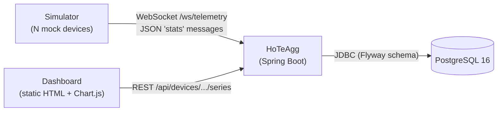

# HoTeAgg: Host Telemetry Aggregator

Kotlin / Spring Boot backend that receives host telemetry over WebSocket, stores it in PostgreSQL and serves
chart-ready time series over REST. A standalone simulator produces mock devices and a static HTML dashboard
charts the data returned by the API.

## Overview



- **Ingestion:** devices send `stats` messages to `ws://<host>:8080/ws/telemetry`; each is validated, stored once and acknowledged (`PERSISTED`, `DUPLICATE`, `INVALID`, `FAILED`).
- **Persistence:** measurements go to `telemetry_metrics` (metrics as JSONB); every received message is also kept in `device_message_history`.
- **Charts API:** `GET /api/devices/{deviceId}/metrics/{metric}/series?range=1h|24h|7d` returns raw points (1h) or averaged buckets (24h: 5 min, 7d: 30 min).
- **Simulator:** `simulator/` module; correlated random-walk hardware-like values (CPU, memory, rx/tx, power, temperature) with random spikes and reconnect with backoff.
- **Dashboard:** served at `/`; fetches the Charts API (no direct DB access, no mock data).

## Features and status

| Feature | Status | Notes |
|---|---|---|
| Kotlin backend (Spring Boot, Java 21, Maven) | Working | Spring MVC + WebSocket, JDBC, no ORM |
| WebSocket ingestion and validation | Working | Type, device ID, ISO-8601 timestamp, numeric/finite stats, plausibility ranges |
| PostgreSQL + Flyway | Working | Migration `V1` applied on startup; volume `pgdata` in Compose |
| TimescaleDB | Not used yet | Plain `postgres:16`; planned (see Next steps) |
| Dynamic metrics in JSONB | Working | Any numeric metric stored; chart API exposes 6 allow-listed metrics |
| Message history, duplicates | Working | `UNIQUE (device_id, client_timestamp)` + `ON CONFLICT DO NOTHING` |
| Charts REST API | Working | 1h raw, 24h 5-min, 7d 30-min buckets |
| Mock device simulator | Working | Concurrent devices, spikes, reconnect; no gaps/duplicates yet |
| HTML dashboard | Working | Device/metric/range, loading/empty/error states, auto-refresh, stale-request protection |
| Tests | Working | 54 backend (unit + Testcontainers integration), 8 simulator, 12 dashboard-logic: all passed |
| Health, OpenAPI | Working | `/actuator/health`, `/swagger-ui.html`, `/v3/api-docs` |
| Metrics/alerts, caching, reverse proxy, load test | Not present | Scalability is **not** demonstrated |

## Architecture and design decisions

Flow: Simulator → WebSocket → `TelemetryWebSocketHandler` → `TelemetryIngestionService` → PostgreSQL → `SeriesController` → Dashboard.

- **Kotlin + Spring Boot:** concise code; mature WebSocket, JDBC, Flyway, Actuator, Testcontainers support.
- **Persistent DB:** data must survive restarts and be queryable by time range (volume `pgdata`; restart persistence observed manually).
- **TimescaleDB:** natural fit for time series (hypertable, `time_bucket`, retention, continuous aggregates). Not used in the current code; chart buckets are computed with epoch-floor SQL.
- **JSONB:** new metric names need no migration. Trade-off: values are extracted per row at query time (`stats ->> key`), which is slower for aggregation than typed columns. Acceptable for one device, one metric, bounded window; not benchmarked.
- **Timestamps:** the device `timestamp` (normalised to UTC) is the measurement time used for uniqueness and charts; `server_received_at` is stored but not used for charts. No clock-drift handling.
- **Duplicates / out-of-order:** same `(deviceId, timestamp)` is answered `DUPLICATE` (first write wins); late messages are accepted and sorted by timestamp on read. The per-message UUID is server-generated and is not a deduplication key.
- **Concurrency:** blocking handler on Spring threads; one thread per simulated device. Coroutines are declared in `pom.xml` but not used.

## Quick start (Docker: service + mock devices + dashboard)

Three containers start together: `postgres` (database), `app` (HoTeAgg API + dashboard, port 8080) and `simulator` (mock devices sending telemetry to the app over WebSocket).
Prerequisites: Docker, Docker Compose and JDK 21+ (to build the two jars with `./mvnw`).
If `docker compose ...` fails with `unknown shorthand flag: 'd'`, the Compose plugin is missing: use the standalone binary `docker-compose` (with a hyphen) in every command below
(`brew install docker-compose`), or enable the plugin: `mkdir -p ~/.docker/cli-plugins && ln -sf "$(which docker-compose)" ~/.docker/cli-plugins/docker-compose`.

```bash
./mvnw -DskipTests package && (cd simulator && ../mvnw -q package)   # build both jars on the host
docker-compose up -d              # postgres + app (jar mounted) + simulator (jar mounted); or: docker compose up -d
docker-compose ps                 # postgres, app, simulator running
docker-compose logs -f simulator  # per-message "Ack: PERSISTED" lines (DEBUG level)

open http://localhost:8080        # dashboard: device host-0001, pick metric and range; data appears after ~10-20 s
curl "http://localhost:8080/api/devices/host-0001/metrics/cpuUtilPct/series?range=1h"
curl http://localhost:8080/actuator/health

docker-compose down               # add -v to delete the database volume
```

**Verified:** with this single `docker-compose.yml`, all three containers ran, health `UP`, the series API returned simulator data, `GET /` returned 200.
The compose file mounts the host-built jars into `eclipse-temurin:21-jre` containers instead of building images, because the Maven download inside the Docker build
failed in the review environment (`wget: Failed to fetch https://repo.maven.apache.org/...`, typically a TLS-intercepting proxy). The `Dockerfile`s in the repo root and
`simulator/` are not used by Compose; building them was not verified (a `.dockerignore` entry that hid `.mvn` from the build context was fixed).

Configuration (env or `.env`, see `.env.example`): `POSTGRES_DB`, `POSTGRES_USER`, `POSTGRES_PASSWORD`, `POSTGRES_PORT`, `SERVER_PORT`, `SIMULATOR_DEVICES` (3), `SIMULATOR_INTERVAL_SECONDS` (10).
More devices, faster: `SIMULATOR_DEVICES=5 SIMULATOR_INTERVAL_SECONDS=2 docker-compose up -d`.
Standalone simulator options: `--url`, `--devices`, `--interval-seconds`, `--duration-seconds`, `--seed`.

Tests: `./mvnw verify` (integration tests need Docker; on Colima set `DOCKER_HOST=unix://$HOME/.colima/default/docker.sock` and `TESTCONTAINERS_DOCKER_SOCKET_OVERRIDE=/var/run/docker.sock`), `(cd simulator && ../mvnw test)`, `node --test src/test/js/series-api.test.mjs`.


## Next steps

### Already implemented from the engineering notes
- Hardware-like simulator data with spikes and random variation (`DeviceTelemetry`), multiple concurrent devices.
- Simulator reconnect with exponential backoff and jitter after dropped connection or send failure.
- Duplicate messages handled idempotently (unique constraint, `DUPLICATE` ack); invalid payloads and persistence failures recorded in message history.
- Client timestamp (device) vs server receive timestamp stored separately, normalised to UTC.
- HTML dashboard on real API data; device/metric/range selection, units, loading/empty/error states.
- Unit + integration tests (Testcontainers); OpenAPI/Swagger; Actuator health (liveness/readiness); Flyway migrations; persistent Docker volume for PostgreSQL.
- Server-generated message UUID per received message (history); devices do not send their own ID.

### Planned
1. **TimescaleDB extension (next focus).** Switch the Compose image to `timescale/timescaledb`, add a Flyway migration `CREATE EXTENSION timescaledb` and convert `telemetry_metrics` to a hypertable on `client_timestamp` (the unique key must include the partition column, which `(device_id, client_timestamp)` already does). Replace epoch-floor bucketing with `time_bucket()`, add continuous aggregates for 24h/7d and retention/compression policies. Read the docs first (note 14) and benchmark JSONB aggregation (note 16) before and after; decide on typed columns or expression indexes only if the numbers require it.
2. **Observability:** Micrometer counters (received/persisted/duplicate/failed), active WebSocket session gauge, alerts on failure rate; later OpenTelemetry to Application Insights or Grafana/Elastic (Kibana).
3. **Connection reliability:** server heartbeat/idle timeout; decide whether coroutines are worth using or drop the dependency.
4. **Simulator scenarios:** gaps, duplicate messages, delayed/out-of-order timestamps, clock offset, deliberate disconnects; optional mock server for simulator tests. The note "GAP Air simulator" is unclear; presumably "gap" mode.
5. **Timestamp policy:** reject/flag device timestamps far from server time and document how device clock drift affects charts.
6. **Dashboard:** verify in a browser with simulator data (hardware data screenshot); device list/status.
7. **Caching:** cache frequently requested chart queries (e.g. Redis for the last week of data) after measuring query cost.
8. **Nginx** reverse proxy in front of API and WebSocket. Add loadbalancer for multiple ingestion nodes, with sticky sessions for WebSocket.
9. **Load test:** bounded run with hundreds/thousands of simulated devices, recording CPU, memory and query latency.

### Larger / production-scale
- Load balancer / WebSocket gateway and horizontal scaling of ingestion nodes.
- Kafka between ingestion and persistence.
- Device table for status (online/last seen).
- CI/CD with GitHub Actions: build, unit tests, integration tests, Docker build, Sonar, release-please (a mock workflow and `release-please.yml` exist, but the workflow references a missing `./helm/hoteagg` chart and has not run).
- Deployment to Azure Container Apps (or AWS equivalent): Helm charts, manifests, Argo CD, Terraform infrastructure repo.
- Persistent volume claim for PostgreSQL in Kubernetes, backups and retention.

